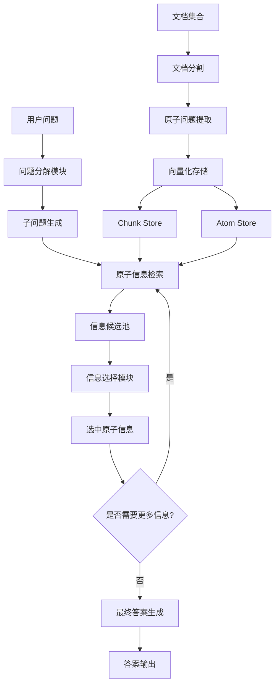

# PIKE-RAG 项目深度理解报告

## 项目概述

### 项目定义
PIKE-RAG（sPecIalized KnowledgE and Rationale Augmented Generation）是微软开发的一个专业知识与推理增强生成系统，代表了检索增强生成（RAG）技术的重要进化。该项目专门针对工业应用中复杂的多跳推理问答任务，通过引入专业知识提取和连贯推理逻辑构建，显著提升了大语言模型在专业领域的问答能力。

### 核心创新点
1. **原子级知识分解**：将复杂问题分解为原子级子问题，实现更精确的知识检索
2. **分层知识检索**：结合文档块（Chunk）和原子问题（Atom）的双层检索架构
3. **知识感知推理**：构建连贯的推理链，逐步引导LLM得出准确答案
4. **多粒度知识提取**：支持从事实检索到创新生成的多层次能力

### 技术背景
传统RAG系统主要依赖直接检索，在处理需要深层领域知识和逻辑推理的复杂工业应用时存在局限性。PIKE-RAG通过以下方式解决这些挑战：
- 改进知识分割策略，保持语义连贯性
- 增强专业术语和别名的对齐能力
- 构建多步推理能力，支持复杂查询

## 技术架构深度分析

### 整体架构设计

PIKE-RAG采用模块化设计，主要包含以下核心模块：

```
PIKE-RAG 系统架构
├── 文档处理层 (Document Processing)
│   ├── 文档加载器 (Document Loaders)
│   ├── 文档转换器 (Document Transformers)
│   │   ├── 分割器 (Splitters)
│   │   ├── 标记器 (Taggers)
│   │   └── 过滤器 (Filters)
│   └── 知识提取 (Knowledge Extraction)
├── 知识存储层 (Knowledge Storage)
│   ├── 文档块存储 (Chunk Store)
│   ├── 原子问题存储 (Atom Store)
│   └── 向量数据库 (Vector Database - Chroma)
├── 检索层 (Retrieval Layer)
│   ├── 基础检索器 (Base Retrievers)
│   ├── 块-原子检索器 (ChunkAtomRetriever)
│   └── 查询解析器 (Query Parsers)
├── 推理层 (Reasoning Layer)
│   ├── 问题分解 (Question Decomposition)
│   ├── 原子选择 (Atom Selection)
│   └── 推理链构建 (Reasoning Chain)
├── 工作流层 (Workflow Layer)
│   ├── QA工作流 (QA Workflow)
│   ├── 分解工作流 (Decomposition Workflow)
│   └── 其他专门工作流
└── LLM交互层 (LLM Client Layer)
    ├── Azure OpenAI客户端
    ├── 标准OpenAI API客户端
    └── Meta Llama客户端
```

### 核心组件详细分析

#### 1. ChunkAtomRetriever - 双层检索架构

这是PIKE-RAG的核心创新组件，实现了文档块和原子问题的双层检索：

**设计理念**：
- **Chunk Store**：存储原始文档片段，保持完整的上下文信息
- **Atom Store**：存储从文档中提取的原子级问题，每个原子问题通过`source_chunk_id`链接到对应的文档块

**检索策略**：
```python
# 三种检索方法的层次化设计
1. retrieve_atom_info_through_atom()  # 通过原子问题检索
2. retrieve_atom_info_through_chunk() # 通过文档块检索  
3. retrieve_contents_by_query()       # 混合检索策略
```

**技术优势**：
- 支持多粒度信息检索
- 保持语义连贯性
- 提供可追溯的信息来源

#### 2. QaDecompositionWorkflow - 问题分解工作流

实现了复杂问题的逐步分解和求解：

**核心流程**：
```
1. 问题分解提议 (Decomposition Proposal)
   ├── 分析当前上下文
   ├── 生成子问题列表
   └── 评估分解必要性

2. 信息检索 (Information Retrieval)
   ├── 基于子问题检索原子信息
   ├── 过滤重复信息源
   └── 备用检索策略

3. 信息选择 (Information Selection)
   ├── 评估候选信息相关性
   ├── 选择最有用的原子信息
   └── 备用选择策略

4. 最终答案生成 (Final Answer Generation)
   ├── 整合选中的原子信息
   ├── 构建推理链
   └── 生成最终答案
```

**关键参数**：
- `max_num_question`: 最大子问题数量（默认5）
- `question_similarity_threshold`: 问题相似度阈值（默认0.9）

#### 3. 提示词工程系统

PIKE-RAG采用了精心设计的提示词模板系统：

**分解提示词**（`question_decomposition_template`）：
- 引导LLM分析问题和上下文
- 生成多样化的子问题
- 支持中英文双语

**选择提示词**（`atom_question_selection_template`）：
- 评估原子信息的相关性
- 避免选择已知信息
- 提供备用选择策略

**答案生成提示词**（`final_qa_protocol`）：
- 整合多源信息
- 构建连贯推理
- 生成可追溯的答案

### 数据流分析



## 技术特色与创新

### 1. 原子级知识分解技术

**核心思想**：将复杂的专业文档分解为原子级的问题-答案对，每个原子问题代表一个独立的知识点。

**实现机制**：
- 使用LLM从文档块中提取原子问题
- 每个原子问题保持与源文档的链接关系
- 支持多粒度的知识表示

**技术优势**：
- 提高检索精度
- 支持细粒度知识访问
- 便于知识组合和推理

### 2. 分层检索架构

**设计原理**：
```python
class ChunkAtomRetriever:
    def __init__(self):
        self._chunk_store: Chroma  # 文档块存储
        self._atom_store: Chroma   # 原子问题存储
```

**检索策略层次**：
1. **主要策略**：通过原子问题检索相关信息
2. **备用策略1**：通过原始查询在原子存储中检索
3. **备用策略2**：直接在文档块存储中检索

**容错机制**：
- 多层次的检索备份
- 智能的信息过滤
- 动态的检索策略调整

### 3. 知识感知推理

**推理链构建**：
- 逐步收集相关原子信息
- 构建连贯的推理逻辑
- 支持多步推理过程

**上下文管理**：
- 动态维护推理上下文
- 避免信息重复和冲突
- 保持推理的连贯性

### 4. 多模态工作流支持

PIKE-RAG支持多种工作流模式：

**L1级别 - 事实信息检索**：
- 专注于准确的事实查找
- 适用于医疗记录查询等场景

**L4级别 - 创新生成**：
- 支持基于事实的创新建议
- 适用于治疗方案制定等复杂场景

## 实验性能分析

### 公开基准测试结果

在多个多跳问答数据集上的表现：

| 数据集 | 准确率 (EM) | F1分数 |
|--------|-------------|--------|
| HotpotQA | 87.6% | - |
| 2WikiMultiHopQA | 82.0% | - |
| MuSiQue | 59.6% | - |

### MuSiQue详细实验结果

在500个随机样本上的对比实验：

| 方法 | EM | F1 |
|------|----|----|
| Zero-Shot CoT | 12.9 | 22.9 |
| w/ Chunk Retrieval | 28.7 | 39.1 |
| Self-Ask w/ Retrieval | 30.0 | 43.4 |
| **Decompose w/ Hierarchical Retrieval** | **41.5** | **51.6** |

**性能提升分析**：
- 相比传统RAG方法提升44.6%（EM指标）
- 相比Self-Ask方法提升38.3%（EM指标）
- 在复杂多跳推理任务上表现尤为突出

### 评估指标体系

PIKE-RAG采用多维度评估指标：

1. **准确性指标**：
   - Exact Match (EM)
   - F1 Score
   - Precision & Recall

2. **推理质量指标**：
   - LLM-Accuracy（基于LLM的自动评估）
   - 推理链连贯性
   - 信息来源可追溯性

3. **鲁棒性指标**：
   - 对抗攻击抵抗能力
   - 幻觉率测量
   - 跨领域泛化能力

## 工程实现深度分析

### 代码架构设计

**模块化设计原则**：
```python
# 核心模块结构
pikerag/
├── workflows/          # 工作流控制
├── knowledge_retrievers/  # 知识检索
├── document_transformers/ # 文档处理
├── llm_client/        # LLM客户端
├── prompts/           # 提示词管理
└── utils/             # 工具函数
```

**设计模式应用**：
- **策略模式**：多种检索策略的动态选择
- **模板方法模式**：工作流的标准化流程
- **工厂模式**：LLM客户端的动态创建
- **观察者模式**：API监控和日志记录

### 配置管理系统

**YAML配置驱动**：
```yaml
# 完整的配置体系
workflow:           # 工作流配置
  module_path: pikerag.workflows.qa_decompose
  class_name: QaDecompositionWorkflow
  args:
    max_num_question: 5

retriever:          # 检索器配置
  module_path: pikerag.knowledge_retrievers
  class_name: ChunkAtomRetriever
  
llm_client:         # LLM客户端配置
  module_path: pikerag.llm_client
  class_name: CompanyOpenAIClient
```

**动态加载机制**：
```python
# 支持运行时动态加载组件
def load_class(module_path: str, class_name: str, base_class):
    module = importlib.import_module(module_path)
    cls = getattr(module, class_name)
    assert issubclass(cls, base_class)
    return cls
```

### 监控与日志系统

**API监控功能**：
```python
class APIMonitor:
    def __init__(self, window_minutes: int = 1):
        self.requests: List[RequestStats] = []
        self._rpm_window: List[float] = []
    
    def record_request(self, duration, response, model, success):
        # 记录请求统计信息
        # 监控RPM和Token使用
        # 性能分析和报告
```

**多层次日志记录**：
- 实验级别日志
- 组件级别日志  
- API调用日志
- 性能监控日志

### 数据处理流水线

**数据预处理流程**：
```python
# 数据处理主流程
1. 数据集重格式化 (reformat_dataset)
2. 样本采样 (sample_datasets)  
3. 文档分块 (chunk processing)
4. 原子问题提取 (atom extraction)
5. 向量化存储 (vector storage)
```

**支持的数据格式**：
- JSONL格式的问答数据
- 多种文档格式（通过unstructured库）
- 向量数据库存储格式

## 应用场景与用例分析

### 工业应用场景

**1. 医疗健康领域**：
- **患者历史记录查询**：精确检索患者的历史医疗信息
- **治疗方案建议**：基于医学知识库生成个性化治疗建议
- **药物相互作用分析**：多源信息整合的安全性评估

**2. 制造业**：
- **设备故障诊断**：基于历史故障数据的智能诊断
- **工艺优化建议**：结合多个工艺参数的优化方案
- **质量控制分析**：多维度质量数据的综合分析

**3. 金融服务**：
- **风险评估报告**：整合多源数据的风险分析
- **投资建议生成**：基于市场数据的投资策略
- **合规性检查**：法规文档的智能解读和应用

### 技术能力层次

**L1级别 - 事实信息检索**：
```
特点：专注于准确的事实查找
技术：上下文感知分割 + 术语对齐 + 多粒度提取
应用：医疗记录查询、技术文档检索
```

**L2级别 - 知识感知分解**：
```
特点：支持复杂问题的分解和推理
技术：问题分解 + 分层检索 + 推理链构建
应用：多步骤问题解答、决策支持
```

**L4级别 - 创新生成**：
```
特点：基于事实的创新建议和方案生成
技术：多智能体规划 + 创造性推理 + 可靠性保证
应用：治疗方案制定、产品设计建议
```

## 技术优势与局限性

### 核心技术优势

**1. 精确的知识检索**：
- 原子级知识分解提高检索精度
- 多层次检索策略确保信息完整性
- 语义连贯性保持提升用户体验

**2. 强大的推理能力**：
- 支持多步推理和复杂逻辑
- 可追溯的推理链增强可信度
- 动态上下文管理优化推理质量

**3. 高度的可扩展性**：
- 模块化架构支持灵活扩展
- 配置驱动的组件管理
- 多种LLM后端支持

**4. 工业级的可靠性**：
- 完善的监控和日志系统
- 多层次的容错机制
- 严格的评估和测试体系

### 技术局限性

**1. 计算资源需求**：
- 双层向量存储增加存储成本
- 多步推理过程增加计算开销
- LLM调用频次较高

**2. 领域适应性**：
- 需要领域专家进行定制化配置
- 提示词工程需要专业知识
- 不同领域的性能差异较大

**3. 语言支持限制**：
- 主要针对英语进行优化
- 其他语言需要额外的提示词工程
- 跨语言性能有待验证

**4. 数据依赖性**：
- 需要高质量的领域数据
- 原子问题提取质量影响整体性能
- 数据预处理工作量较大

## 部署与运维指南

### 环境配置要求

**基础环境**：
```bash
# Python环境
Python >= 3.8
pip install -r requirements.txt
pip install -r examples/requirements.txt

# 环境变量设置
export PYTHONPATH=$PWD
```

**依赖组件**：
- **向量数据库**：ChromaDB
- **LLM服务**：Azure OpenAI / OpenAI API / Meta Llama
- **文档处理**：unstructured, spacy, transformers
- **机器学习**：torch, sentence-transformers, langchain

### 配置管理

**环境变量配置**（`.env`文件）：
```ini
# Azure OpenAI配置
AZURE_OPENAI_ENDPOINT=https://xxx.openai.azure.com/
OPENAI_API_VERSION=2024-08-01-preview
AZURE_OPENAI_API_KEY=your-api-key

# 监控配置
MONITORING_ENABLE=true
RPM_WINDOW_MINUTES=1
```

**YAML配置文件**：
- 实验配置：`experiment_name`, `log_dir`, `test_rounds`
- 工作流配置：`workflow`, `retriever`, `llm_client`
- 评估配置：`evaluator`, `metrics`

### 运行流程

**1. 数据准备**：
```bash
# 数据预处理
python data_process/main.py configs/data_config.yml

# 向量存储构建
python examples/chunking.py
python examples/tagging.py
```

**2. 实验运行**：
```bash
# 运行QA实验
python examples/qa.py configs/atomic_decompose.yml

# 运行评估
python examples/evaluate.py configs/evaluate.yml
```

**3. 结果分析**：
- 查看日志文件：`logs/{experiment_name}/`
- 分析性能指标：CSV格式的评估结果
- 监控API使用：监控报告和统计信息

### 性能优化建议

**1. 检索优化**：
- 调整`retrieve_k`参数平衡精度和效率
- 设置合适的`retrieve_score_threshold`过滤低质量结果
- 使用`atom_retrieve_k`控制原子检索数量

**2. 推理优化**：
- 限制`max_num_question`避免过度分解
- 调整`question_similarity_threshold`控制问题去重
- 优化提示词模板提高推理效率

**3. 资源管理**：
- 启用API监控控制调用频率
- 使用缓存机制减少重复调用
- 合理配置并行度`num_parallel`

## 未来发展方向

### 技术演进路线

**1. 知识表示增强**：
- 支持更复杂的知识图谱结构
- 引入多模态知识表示
- 增强知识的时序和版本管理

**2. 推理能力提升**：
- 支持更长的推理链
- 引入符号推理和神经推理的结合
- 增强反事实推理能力

**3. 多语言支持**：
- 扩展到更多语言的支持
- 跨语言知识检索和推理
- 多语言提示词工程自动化

**4. 效率优化**：
- 推理过程的并行化
- 智能缓存和预计算
- 模型压缩和加速技术

### 应用领域拓展

**1. 新兴应用场景**：
- 科学研究辅助
- 法律文档分析
- 教育内容生成
- 创意写作支持

**2. 行业深度定制**：
- 垂直领域的专门优化
- 行业标准的深度集成
- 监管合规的自动化支持

**3. 人机协作模式**：
- 交互式问答系统
- 专家知识的增强学习
- 人类反馈的持续优化

## 总结与评价

### 项目价值评估

**技术创新价值**：
PIKE-RAG在RAG技术领域实现了重要突破，特别是在原子级知识分解和分层检索架构方面的创新，为复杂推理任务提供了新的解决方案。

**工程实现价值**：
项目采用了优秀的软件工程实践，模块化设计、配置驱动、完善的监控和日志系统，为工业级应用奠定了坚实基础。

**学术研究价值**：
在多个公开基准测试中取得了显著的性能提升，为RAG技术的发展提供了重要的理论和实践贡献。

**产业应用价值**：
针对工业应用的特殊需求进行了深度优化，在医疗、制造、金融等领域具有广阔的应用前景。

### 技术成熟度分析

**优势方面**：
- 核心技术架构设计合理
- 实验验证充分，性能提升显著
- 代码质量高，工程化程度好
- 文档完善，易于理解和使用

**改进空间**：
- 计算效率有待进一步优化
- 多语言支持需要加强
- 领域适应性需要更多验证
- 用户界面和交互体验可以提升

### 推荐使用场景

**强烈推荐**：
- 需要复杂多跳推理的问答任务
- 专业领域的知识检索和应用
- 对答案可追溯性要求较高的场景
- 有充足计算资源的工业应用

**谨慎使用**：
- 对实时性要求极高的应用
- 计算资源受限的环境
- 非英语为主的应用场景
- 缺乏领域专家支持的项目

PIKE-RAG代表了RAG技术发展的重要里程碑，其创新的技术架构和优秀的工程实现为复杂推理任务提供了强有力的解决方案。随着技术的不断完善和应用场景的扩展，PIKE-RAG有望在更多领域发挥重要作用，推动人工智能技术在工业应用中的深度发展。 