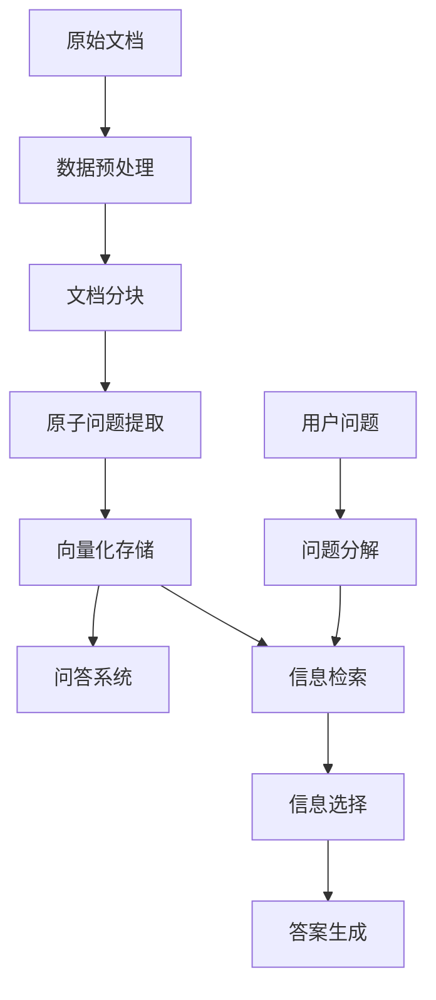

# 🏗️ PIKE-RAG 建筑工程规范智能问答系统

基于 PIKE-RAG 技术的建筑工程规范智能问答系统，支持复杂推理和多跳问答。

## 📋 功能特性

- 🔍 **智能检索**: 基于向量数据库的语义检索
- 🧠 **复杂推理**: 支持问题分解和多步推理
- 📚 **专业知识**: 针对建筑工程规范文档优化
- 🌏 **中文支持**: 完整的中文问答支持
- 🎯 **自动验证**: 内置问答对验证功能
- 💬 **交互式界面**: 友好的命令行交互体验

## 🗂️ 项目结构

```
research_project/
├── configs/                   # 配置文件
│   ├── chunking_config.yml   # 文档分块配置
│   └── qa_config.yml         # 问答系统配置
├── scripts/                   # 执行脚本
│   ├── data_preprocessing.py  # 数据预处理
│   ├── pike_rag_processing.py # PIKE-RAG数据处理
│   ├── build_vector_store.py  # 向量存储构建
│   └── interactive_qa.py      # 交互式问答
├── data_process/             # 原始数据
│   ├── markdown/             # 建筑规范文档(MD格式)
│   └── qa_examples.xlsx      # 问答样例
├── processed_data/           # 处理后数据
├── chunked_data/            # 分块后数据
├── vector_stores/           # 向量数据库
├── logs/                    # 日志文件
├── run_pipeline.py          # 完整流水线脚本
└── README.md               # 项目说明
```

## 🚀 快速开始

### 1. 环境准备

确保已安装所需依赖：
```bash
pip install -r requirements.txt
pip install -r examples/requirements.txt
pip install sentence-transformers
```

### 2. 完整流水线执行

运行完整的数据处理和问答系统部署：

```bash
# 执行完整流水线
python research_project/run_pipeline.py --step all

# 或分步执行
python research_project/run_pipeline.py --step preprocess  # 数据预处理
python research_project/run_pipeline.py --step chunk      # 文档分块
python research_project/run_pipeline.py --step vector     # 向量存储
python research_project/run_pipeline.py --step qa         # 问答系统
```

### 3. 启动交互式问答

```bash
python research_project/scripts/interactive_qa.py
```

## 💡 使用说明

### 交互式问答系统

启动后，您可以：

- 📝 **直接提问**: 输入建筑工程相关问题
- 🔍 **查看示例**: 输入 `examples` 查看预置问题
- ✅ **运行验证**: 输入 `validate` 测试系统准确性
- ❓ **获取帮助**: 输入 `help` 查看详细说明
- 🚪 **退出系统**: 输入 `quit` 或 `exit`

### 示例问题

```
1. 建筑电气工程施工质量验收规范中对接地系统有什么要求？
2. 地下防水工程的验收标准是什么？
3. 建筑基桩检测的主要方法有哪些？
4. 临时用电安全技术标准的核心要求是什么？
```

## 🔧 配置说明

### LLM 配置

系统使用 Company OpenAI 客户端，需要配置环境变量：

```bash
export COMPANY_OPENAI_API_KEY=your-company-openai-api-key
export COMPANY_OPENAI_BASE_URL=https://aigc.sankuai.com/v1/openai/native
export COMPANY_OPENAI_TRACE_ID=your-trace-id  # 可选
```

或者复制配置示例文件：
```bash
cp research_project/configs/company_openai_config.yml.example research_project/configs/company_openai_config.yml
# 编辑配置文件填入正确的API信息
```

## ✅ 最新更新：Mock逻辑修正

### 已修正的Mock逻辑

1. **原子问题生成** ✅
   - **之前**: 使用简单关键词匹配生成问题
   - **现在**: 使用CompanyOpenAI LLM + PIKE-RAG专用prompt生成高质量原子问题
   - **回退机制**: 当LLM不可用时，使用改进的关键词匹配方法

2. **Embedding调用** ✅
   - **之前**: 调用不存在的`get_embeddings`方法
   - **现在**: 使用正确的`embed_query`和`embed_documents`方法
   - **回退机制**: CompanyOpenAI → sentence-transformers → 零向量

3. **错误处理** ✅
   - 增加了完善的异常处理和回退机制
   - 提供详细的错误信息和解决建议

### 测试LLM集成

运行测试脚本验证LLM集成是否正常：

```bash
python research_project/scripts/test_llm_integration.py
```

该脚本会测试：
- 环境变量配置
- LLM客户端基本功能
- 原子问题生成
- Embedding客户端

### 参数调优

主要配置文件：

- `qa_config.yml`: 问答系统参数
  - `max_num_question`: 最大子问题数量
  - `retrieve_k`: 检索文档数量
  - `temperature`: LLM 生成温度

## 📊 系统架构



## 🎯 验证功能

系统内置验证功能，自动对比系统回答与标准答案：

```bash
# 在交互式界面中输入
validate
```

验证过程会：
1. 加载预置的问答对
2. 逐一测试系统回答
3. 显示标准答案对比
4. 计算准确率统计

## 📈 性能优化

### 检索优化
- 调整 `retrieve_k` 参数平衡精度和效率
- 设置 `retrieve_score_threshold` 过滤低质量结果

### 推理优化
- 限制 `max_num_question` 避免过度分解
- 调整 `question_similarity_threshold` 控制问题去重

### 资源管理
- 启用 API 监控控制调用频率
- 使用缓存机制减少重复调用

## 🔍 故障排除

### 常见问题

1. **向量存储构建失败**
   - 检查网络连接和 API 配置
   - 可以跳过向量构建使用本地模型

2. **问答系统启动失败**
   - 确认所有数据文件已生成
   - 检查配置文件路径

3. **回答质量不佳**
   - 调整检索参数
   - 增加文档数据量
   - 优化提示词模板

### 日志查看

```bash
# 查看处理日志
ls research_project/logs/

# 查看特定实验日志
tail -f research_project/logs/building_regulations_qa/experiment.log
```

## 🤝 贡献指南

欢迎提交问题和改进建议！

## 📄 许可证

本项目基于 MIT 许可证开源。

---

🎉 享受使用 PIKE-RAG 建筑工程规范智能问答系统！ 